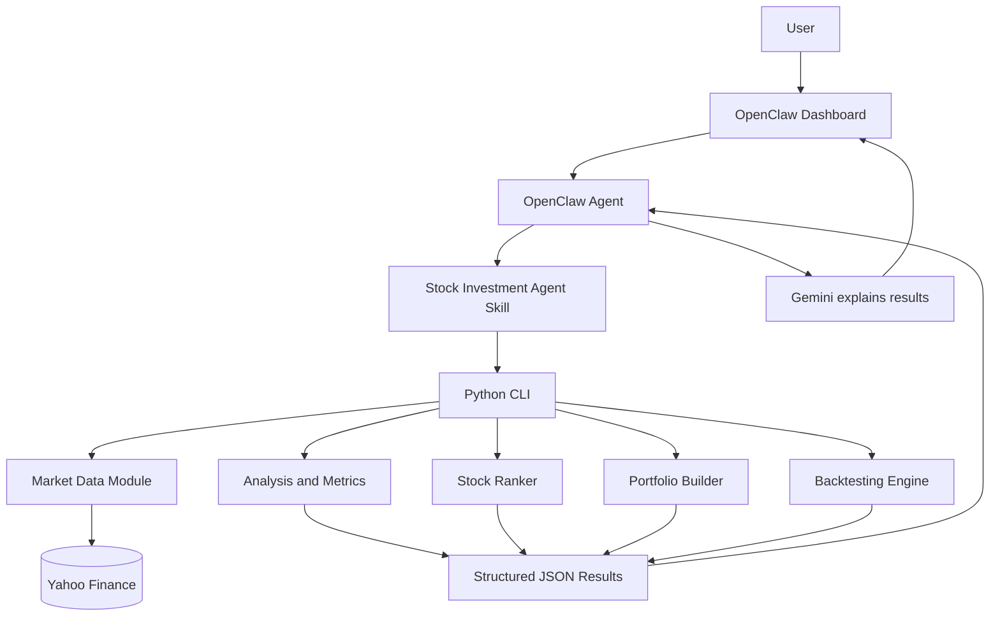

<div align="center">

# 📈 OpenClaw AI Stock Investment Agent

### AI-assisted stock analysis, risk evaluation, portfolio construction, and historical backtesting

<p>
  
  
  
  
  
  
  
</p>

<p>
  <strong>4 analytical capabilities</strong> ·
  <strong>Weighted stock ranking</strong> ·
  <strong>Budget-based portfolio simulation</strong> ·
  <strong>Historical backtesting</strong>
</p>

<a href="https://github.com/stivanpashaliev/openclaw-stock-investment-agent">View the repository</a>

</div>

---

> **TL;DR** — **OpenClaw AI Stock Investment Agent** is a Python-based
> stock research and portfolio simulation project integrated with the
> OpenClaw AI agent framework. It retrieves historical market prices,
> calculates return and risk metrics, ranks a selected group of stocks
> using a transparent weighted scoring model, builds a simulated
> portfolio from a user-defined budget, and evaluates portfolio
> performance through historical backtesting. OpenClaw and Google Gemini
> provide the conversational interface; Python performs the
> deterministic financial calculations.

---

## 📑 Table of Contents

- [Overview](#-overview)
- [Key Features](#-key-features)
- [How It Works](#-how-it-works)
- [Stock Ranking Methodology](#-stock-ranking-methodology)
- [Portfolio Construction](#-portfolio-construction)
- [Backtesting Methodology](#-backtesting-methodology)
- [Technology Stack](#️-technology-stack)
- [Architecture](#-architecture)
- [Project Structure](#-project-structure)
- [Getting Started](#-getting-started)
- [Command-Line Usage](#️-command-line-usage)
- [OpenClaw and Gemini Integration](#-openclaw-and-gemini-integration)
- [Testing](#-testing)
- [Design Decisions](#-design-decisions)
- [Limitations & Future Work](#-limitations--future-work)
- [Disclaimer](#️-disclaimer)
- [References](#-references)
- [Author](#-author)

---

## 🎯 Overview

Investment research often requires several separate steps: collecting
historical prices, measuring performance and risk, comparing securities
consistently, deciding how to distribute a budget, and evaluating how a
portfolio behaved over time.

This project brings those steps into one workflow.

The system combines a **deterministic Python analysis engine** with an
**OpenClaw conversational agent**. A user can request an analysis in
natural language through the OpenClaw Dashboard. The agent follows the
project Skill, invokes the corresponding Python command, and explains
the actual results returned by the engine.

The project is designed for educational and research purposes. It
supports analysis and simulation; it does **not** connect to a brokerage
account or place real orders.

### Project goals

1. Retrieve historical market data for selected stock tickers.
2. Calculate comparable return and risk indicators.
3. Rank stocks using an explicit, configurable-in-code weighting
   methodology.
4. Allocate a user-provided budget across eligible stocks using whole
   shares and a maximum position weight.
5. Simulate historical portfolio performance and calculate
   risk-adjusted performance metrics.
6. Make these capabilities accessible through both a command-line
   interface and OpenClaw.

---

## ✨ Key Features

| Module | Capabilities |
| --- | --- |
| **📡 Market Data** | Retrieves historical OHLCV price data through `yfinance`; supports configurable periods and intervals; normalizes column names for downstream processing. |
| **📊 Stock Analysis** | Calculates total return, annualized volatility, and maximum drawdown for an individual stock. |
| **🏆 Stock Ranker** | Compares a user-selected stock universe, normalizes metrics to a 0–100 scale, applies weighted scores, and sorts the results. |
| **💼 Portfolio Builder** | Distributes a user-defined budget according to ranking scores, enforces a maximum position weight, allocates whole shares, and reports remaining cash. |
| **⏪ Backtesting Engine** | Simulates a weighted portfolio over historical price data and calculates total return, annualized return, volatility, maximum drawdown, and Sharpe ratio. |
| **🤖 OpenClaw Skill** | Connects natural-language requests to the Python engine and guides the agent on workflows, output interpretation, and financial limitations. |
| **⌨️ CLI** | Exposes analysis, ranking, portfolio construction, and backtesting as executable commands with JSON output. |

### Supported analytical operations

- Analyze one ticker over a selected historical period.
- Rank multiple tickers against one another.
- Construct a simulated portfolio from a specified budget.
- Backtest a ranked portfolio using historical prices.

The default analysis period is `1y`. The example stock universe used
during development and demonstrations is `AAPL`, `MSFT`, `NVDA`,
`GOOGL`, and `AMZN`.

---

## 🔁 How It Works

A typical request follows this sequence:

1. The user asks a question in the OpenClaw Dashboard.
2. OpenClaw uses the `stock-investment-agent` Skill to identify the
   requested operation and required inputs.
3. The agent invokes the project's Python CLI through the configured
   execution tool.
4. The Python engine downloads market data and performs the
   calculations.
5. The CLI returns structured JSON output.
6. Gemini interprets and explains the returned figures, including
   relevant assumptions and limitations.

The AI model is responsible for understanding the request and
communicating results. **Financial calculations and portfolio allocation
are performed by Python**, not invented by the language model.

---

## 🧮 Stock Ranking Methodology

The Stock Ranker evaluates each stock using three metrics:

| Metric | Weight | Preferred direction | What it measures |
| --- | ---: | --- | --- |
| **Total Return** | **50%** | Higher is better | Price performance over the selected period. |
| **Annualized Volatility** | **25%** | Lower is better | Dispersion of daily returns, scaled to an annual figure. |
| **Maximum Drawdown** | **25%** | Higher (less negative) is better | Largest peak-to-trough decline during the period. |

### Score calculation

Each metric is normalized relative to the stocks in the selected
comparison universe on a scale from 0 to 100. The normalized values are
combined using the weights above:

```text
Final Score =
    (Return Score × 0.50)
  + (Volatility Score × 0.25)
  + (Drawdown Score × 0.25)
```

For return and drawdown, higher values receive higher normalized scores.
For volatility, lower values receive higher normalized scores.

### Important interpretation

The ranking is **relative to the supplied ticker universe**. A score of
100 means that the stock achieved the highest composite score among the
stocks being compared for that run. It does not mean that the stock is
universally safe, undervalued, or guaranteed to outperform.

Because min-max normalization depends on the selected comparison set,
scores can change when tickers are added or removed.

---

## 💼 Portfolio Construction

The Portfolio Builder converts ranking results into a simulated
allocation.

### Allocation process

1. Stocks with a ranking score greater than zero are considered
   eligible.
2. Each eligible stock receives an initial target weight proportional
   to its ranking score.
3. The algorithm applies the configured maximum position weight
   (default: **40%**) and redistributes excess allocation among
   uncapped positions.
4. The target allocation for each stock is converted into a whole-share
   quantity using its latest available price.
5. The engine calculates the invested amount and remaining cash.

```text
Target Weight = Stock Score / Sum of Eligible Stock Scores

Allocated Budget = Total Budget × Target Weight

Whole Shares = floor(Allocated Budget / Latest Price)

Invested Amount = Whole Shares × Latest Price

Remaining Cash = Total Budget − Total Invested
```

The output includes each holding's ticker, score, target weight,
reference price, number of shares, allocated budget, and invested
amount.

**Why can cash remain uninvested?** The builder purchases whole shares
only. The remaining balance can therefore include unused amounts caused
by share-price rounding, as well as allocation constraints.

The portfolio is a simulation. The program does not submit orders or
execute transactions.

---

## ⏪ Backtesting Methodology

The Backtesting Engine evaluates a portfolio using historical closing
prices and a set of portfolio weights.

The engine calculates daily asset returns, combines them using the
supplied weights, and compounds the resulting portfolio returns from the
specified initial capital. The current implementation assumes **daily
rebalancing** to the target weights.

### Reported metrics

| Metric | Description |
| --- | --- |
| **Total Return** | Overall percentage change in portfolio value during the tested period. |
| **Annualized Return** | Compounded return expressed on an annual basis. |
| **Annualized Volatility** | Standard deviation of periodic portfolio returns scaled by the square root of the periods per year. |
| **Maximum Drawdown** | Largest peak-to-trough decline in portfolio value. |
| **Sharpe Ratio** | Annualized excess return relative to annualized return volatility, using a configurable risk-free rate (0% by default). |

### Backtesting caveat: look-ahead bias

The current CLI workflow derives stock rankings and portfolio weights
from the **same historical period** that is then used for the backtest.
This introduces **look-ahead bias**: information from the tested period
influences the portfolio weights.

Consequently, the current backtest is an illustrative demonstration of
the engine and its metrics. It is **not** a leakage-free predictive
evaluation and must not be interpreted as evidence of future
profitability.

A walk-forward design — where rankings are calculated using only
information available before each test window — is an important future
improvement.

---

## 🛠️ Technology Stack

| Layer | Technology |
| --- | --- |
| Programming language | **Python 3.12** |
| AI agent framework | **OpenClaw** |
| Language model used in the demonstrated setup | **Google Gemini 3 Flash Preview** |
| Market data source / library | **Yahoo Finance via `yfinance`** |
| Data processing | **Pandas** |
| Numerical calculations | **NumPy** |
| Command-line interface | Python `argparse` |
| Output format | JSON |
| Automated testing | **pytest** |
| Version control | **Git** and **GitHub** |

The Gemini model is configured in the OpenClaw environment; it is not
required to run the Python CLI independently.

---

## 🧱 Architecture

The project separates conversational orchestration from deterministic
financial computation.



### Component responsibilities

- **OpenClaw Dashboard** — conversational entry point for user
  requests.
- **OpenClaw Agent** — interprets the request and coordinates tool
  execution.
- **Stock Investment Agent Skill** — documents supported operations,
  command patterns, expected inputs, and financial safety rules.
- **Python CLI** — validates command arguments, calls the relevant
  application module, and serializes results as JSON.
- **Market Data Module** — retrieves and prepares historical price
  data.
- **Analysis and Metrics** — calculate return and risk indicators.
- **Stock Ranker** — normalizes metrics and calculates composite
  scores.
- **Portfolio Builder** — converts scores and current prices into a
  simulated whole-share allocation.
- **Backtesting Engine** — calculates a historical portfolio value
  series and performance metrics.
- **Gemini** — explains actual tool output in natural language; it
  is not the source of the numerical calculations.

### Design principle

The Python engine remains usable without OpenClaw. This separation makes
the financial logic independently testable and allows the conversational
layer to be changed without rewriting the core calculations.

---

## 📁 Project Structure

```text
openclaw-stock-investment-agent/
│
├── docs/                              # Project documentation
│
├── skills/
│   └── stock-investment-agent/
│       └── SKILL.md                   # OpenClaw workflow and usage instructions
│
├── src/
│   └── stock_agent/
│       ├── __init__.py
│       ├── cli.py                     # Command-line entry point
│       │
│       ├── data/
│       │   ├── __init__.py
│       │   └── market_data.py         # Yahoo Finance data retrieval
│       │
│       ├── analysis/
│       │   ├── __init__.py
│       │   ├── metrics.py             # Return and risk metrics
│       │   ├── stock_analysis.py      # Single-stock analysis
│       │   └── stock_ranker.py        # Weighted stock ranking
│       │
│       ├── portfolio/
│       │   ├── __init__.py
│       │   └── portfolio_builder.py   # Budget-based portfolio allocation
│       │
│       └── backtesting/
│           ├── __init__.py
│           ├── engine.py              # Historical portfolio simulation
│           └── metrics.py             # Backtesting performance metrics
│
├── tests/
│   ├── test_metrics.py
│   ├── test_stock_ranker.py
│   ├── test_portfolio_builder.py
│   ├── test_backtesting.py
│   └── test_backtesting_metrics.py
│
├── .gitignore
└── README.md
```

---

## 🚀 Getting Started

The following instructions describe a local Linux setup. The project was
developed and tested in a Python virtual environment.

### 1. Prerequisites

- **Python 3.12**
- **Git**
- Internet access for retrieving market data from Yahoo Finance
- **OpenClaw** and a configured model API key only if you want to use
  the conversational integration

### 2. Clone the repository

```bash
git clone https://github.com/stivanpashaliev/openclaw-stock-investment-agent.git
cd openclaw-stock-investment-agent
```

### 3. Create and activate a virtual environment

```bash
python3 -m venv .venv
source .venv/bin/activate
```

### 4. Install Python dependencies

```bash
python -m pip install --upgrade pip
python -m pip install yfinance pandas numpy pytest
```

### 5. Run a first analysis

From the repository root:

```bash
PYTHONPATH=src .venv/bin/python -m stock_agent.cli analyze --ticker AAPL --period 1y
```

The command prints a JSON result containing the ticker, requested
period, observation count, start and end dates, total return, annualized
volatility, and maximum drawdown.

> Market data is retrieved at runtime. Results depend on data
> availability and can change between runs.

---

## ⌨️ Command-Line Usage

All commands are run from the project root with `PYTHONPATH=src`.

### Analyze one stock

```bash
PYTHONPATH=src .venv/bin/python -m stock_agent.cli analyze \
  --ticker AAPL \
  --period 1y
```

### Rank multiple stocks

```bash
PYTHONPATH=src .venv/bin/python -m stock_agent.cli rank \
  --tickers AAPL,MSFT,NVDA,GOOGL,AMZN \
  --period 1y
```

### Build a simulated portfolio

```bash
PYTHONPATH=src .venv/bin/python -m stock_agent.cli portfolio \
  --tickers AAPL,MSFT,NVDA,GOOGL,AMZN \
  --budget 10000 \
  --period 1y
```

Optional maximum position weight:

```bash
PYTHONPATH=src .venv/bin/python -m stock_agent.cli portfolio \
  --tickers AAPL,MSFT,NVDA,GOOGL,AMZN \
  --budget 10000 \
  --period 1y \
  --max-weight 0.40
```

### Backtest a ranked portfolio

```bash
PYTHONPATH=src .venv/bin/python -m stock_agent.cli backtest \
  --tickers AAPL,MSFT,NVDA,GOOGL,AMZN \
  --capital 10000 \
  --period 1y
```

### CLI options

| Command | Required arguments | Optional arguments |
| --- | --- | --- |
| `analyze` | `--ticker` | `--period` (default: `1y`) |
| `rank` | `--tickers` | `--period` (default: `1y`) |
| `portfolio` | `--tickers`, `--budget` | `--period` (default: `1y`), `--max-weight` (default: `0.40`) |
| `backtest` | `--tickers` | `--capital` (default: `10000`), `--period` (default: `1y`) |

The CLI returns JSON for both successful operations and handled errors,
making the output suitable for programmatic use by OpenClaw.

---

## 🤖 OpenClaw and Gemini Integration

The project includes an OpenClaw Skill at:

```text
skills/stock-investment-agent/SKILL.md
```

The Skill tells the agent when and how to use the Python engine. It
covers the four supported operations, required user inputs, command
examples, interpretation guidance, and financial safety rules.

### Integration flow

1. Install and configure OpenClaw separately.
2. Configure a supported model provider and API key in OpenClaw.
3. Make the project Skill available to the OpenClaw agent's Skills
   directory according to the OpenClaw installation.
4. Ensure the agent's execution tool can run commands in the project
   directory.
5. Restart or reload the OpenClaw Gateway if required by the
   installation.
6. Test the Skill with a simple stock-analysis request.

Example natural-language requests:

```text
Analyze AAPL for the last year. Show total return,
annualized volatility, and maximum drawdown.
```

```text
Rank AAPL, MSFT, NVDA, GOOGL, and AMZN over one year.
Explain the weighted scores.
```

```text
Build a simulated portfolio for a $10,000 budget
using the ranking results.
```

```text
Backtest the ranked portfolio over the last year
and explain the performance metrics and limitations.
```

### Keep credentials out of Git

API keys and Gateway tokens belong in the local OpenClaw configuration
or a secure secret store. **Never paste credentials into source files,
README examples, screenshots, or Git commits.** The Python CLI itself
does not require a Gemini API key.

---

## 🧪 Testing

The project uses `pytest` for automated unit tests.

Run the full test suite:

```bash
PYTHONPATH=src .venv/bin/pytest -v
```

The current verified test suite contains **31 passing tests** covering:

| Test area | Coverage |
| --- | --- |
| **Financial Metrics** | Known return and drawdown values; constant prices; insufficient, zero, and negative price inputs. |
| **Stock Ranker** | Score normalization; lower-is-better metrics; equal values; weighted ranking order; empty ticker input. |
| **Portfolio Builder** | Budget allocation; maximum position weight; zero-score exclusion; invalid budgets; insufficient eligible stocks. |
| **Backtesting Engine** | Portfolio value calculations; constant prices; invalid weights; missing tickers; empty data; invalid capital; duplicate and unsorted dates. |
| **Backtesting Metrics** | Known performance metrics; constant values; insufficient data; invalid values; invalid annualization periods. |

Latest recorded local test result during project validation:

```text
============================== 31 passed ==============================
```

---

## 🧭 Design Decisions

<details>
<summary><strong>Why are financial calculations performed in Python?</strong></summary>

<br>

Financial calculations should be deterministic, repeatable, and
testable. The Python engine owns the numerical logic, while the AI model
handles natural-language interaction and explanation. This separation
reduces the risk of fabricated or inconsistent numerical results.

</details>

<details>
<summary><strong>Why use a weighted ranking model?</strong></summary>

<br>

A weighted model makes the comparison methodology explicit. Return has
the largest contribution, while volatility and drawdown introduce risk
considerations. The weights can be changed in the ranking module and
tested independently.

</details>

<details>
<summary><strong>Why normalize scores relative to the selected universe?</strong></summary>

<br>

The input stocks may have metrics on different scales and with different
preferred directions. Min-max normalization converts them to a common
0–100 scale and allows the weighted score to combine them. The
trade-off is that scores depend on the comparison universe.

</details>

<details>
<summary><strong>Why does the portfolio builder use whole shares?</strong></summary>

<br>

Whole-share allocation keeps the simulation straightforward and makes
the remaining cash visible. It also reflects the fact that
fractional-share support is not assumed by this implementation.

</details>

<details>
<summary><strong>Why integrate with OpenClaw?</strong></summary>

<br>

OpenClaw provides a conversational interface and tool orchestration. The
Skill connects natural-language requests to existing CLI operations
without duplicating the financial logic inside prompts.

</details>

---

## 🔭 Limitations & Future Work

### Current limitations

- **Relative scoring:** ranking scores depend on the tickers included
  in the comparison universe.
- **Historical data dependency:** results depend on the availability
  and quality of data returned by Yahoo Finance.
- **No fundamental analysis:** the current ranking model focuses on
  historical price return and risk metrics; it does not evaluate
  financial statements, valuation multiples, or company fundamentals.
- **No transaction costs:** portfolio simulations do not model
  brokerage fees, taxes, bid-ask spreads, or market impact.
- **Simplified rebalancing:** the backtesting engine assumes daily
  rebalancing to fixed target weights.
- **Look-ahead bias:** the current CLI derives ranking weights from
  the same historical period used for backtesting.
- **No live trading:** the project does not connect to a broker or
  execute buy/sell orders.
- **No investment guarantees:** historical performance and ranking
  scores do not predict future returns.

### Possible extensions

- Implement walk-forward backtesting to avoid look-ahead bias.
- Add transaction costs, slippage, and configurable rebalancing
  schedules.
- Add fundamental indicators and sector-aware comparisons.
- Add benchmark comparison (for example, S&P 500).
- Add charts and exportable research reports.
- Add configurable ranking weights and portfolio constraints.
- Expand integration tests for the complete OpenClaw-to-CLI workflow.
- Add reproducible data snapshots for repeatable backtesting.

---

## ⚠️ Disclaimer

This project is an educational software project and is intended for
research and demonstration purposes only. It does not provide
personalized financial advice, manage investments, connect to brokerage
accounts, or execute trades.

All outputs are based on historical market data and a simplified scoring
and simulation methodology. Historical performance does not guarantee
future results. Users should independently verify data and assumptions
before making financial decisions.

---

## 📚 References

- [OpenClaw Documentation](https://docs.openclaw.ai/)
- [Google Gemini API Documentation](https://ai.google.dev/gemini-api/docs)
- [yfinance Documentation](https://ranaroussi.github.io/yfinance/)
- [Pandas Documentation](https://pandas.pydata.org/docs/)
- [NumPy Documentation](https://numpy.org/doc/)
- [pytest Documentation](https://docs.pytest.org/)

---

## 👤 Author

**Stivan Pashaliev** · [GitHub: @stivanpashaliev](https://github.com/stivanpashaliev)

[Project Repository](https://github.com/stivanpashaliev/openclaw-stock-investment-agent)

<div align="center">

---

<sub>OpenClaw AI Stock Investment Agent — an educational project combining Python-based financial analysis with conversational AI orchestration.</sub>

</div>
